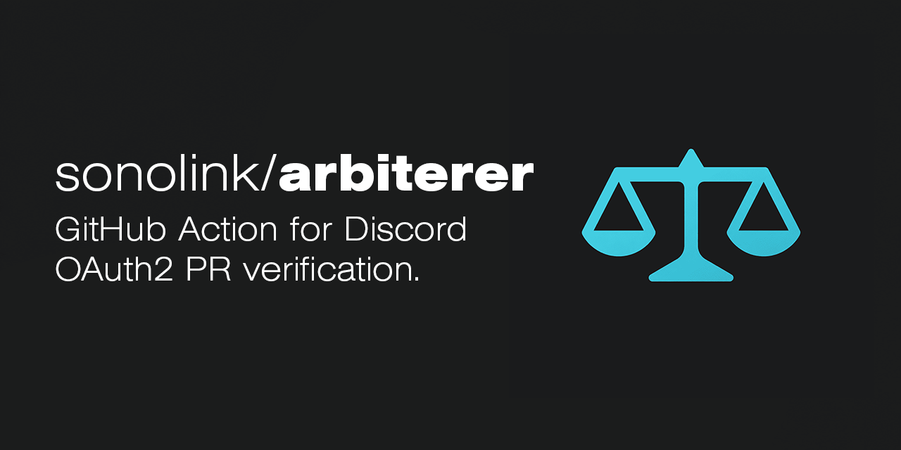

<div align="center">



A GitHub Action that lets your Discord community decide whose contributions get through.

[](LICENSE)
[](https://github.com/sonolink/arbiterer/releases/latest)
[](https://discord.gg/tPHVWBPedt)

</div>

## How it works

1. A contributor opens a pull request.
2. Arbiterer checks whether the author has linked their GitHub account to Discord. If not, it comments with a link to do so.
3. Once linked, your rules run against the author's Discord identity, and the check passes or fails.
4. If the author links their account after a failed check, Arbiterer re-runs the check automatically.

Rules are optional. Without them, authors only need to link their accounts.  
With `close-on-failure`, a failed check closes the pull request and a later pass reopens it.

> [!IMPORTANT]
> Links are **one-to-one per repository**: one GitHub account maps to one Discord account, and vice versa. The same Discord account can be linked to different GitHub accounts in different repositories.

## Getting started

### Install the GitHub App

Install the [Arbiterer GitHub App](https://github.com/apps/arbiterer) on every repository that uses Arbiterer, or on the organization that owns those repositories. The app posts and updates the comments that guide authors through account linking; _without it, every run fails_.

### Add the workflow

Add a workflow to `.github/workflows/`:

> [!WARNING]
> Use `pull_request_target` so fork pull requests run the workflow and rules from your default branch.

```yaml
name: Arbiterer

on:
  pull_request_target:
    types: [opened, synchronize, reopened]

permissions:
  contents: read # Read repository metadata
  pull-requests: write # Open and close pull requests (when close-on-failure is enabled)
  id-token: write # Verify the request comes from this repository (OIDC)

jobs:
  arbiterer:
    runs-on: ubuntu-latest
    steps:
      - uses: sonolink/arbiterer@v1
        with:
          # Exempt the repository owner, organization members, and collaborators.
          exempt-associations: OWNER,MEMBER,COLLABORATOR
```

If you only need authors to link their accounts, this is enough. To enforce conditions on the linked Discord account, add [rules](#rules).

## Usage

### Rechecking a pull request

If a rule failed, the author can request another run without pushing:

```text
/arbiterer recheck
```

Arbiterer adds a thumbs-up reaction when it starts a manual recheck and a confused reaction when the recheck does not start, such as during the cooldown or when no workflow run is available. If Arbiterer cannot authenticate with GitHub, it cannot react.

> [!NOTE]
> Only the pull request author can trigger a manual recheck, at most once every five minutes per pull request. A failed start can be retried immediately. Commands on merged pull requests, or on pull requests closed by someone other than Arbiterer, are ignored without a reaction.

### Closing and reopening pull requests

With `close-on-failure` enabled, a failed check closes the pull request. Arbiterer reopens a pull request it closed once the author links their account or a later check passes. It never reopens a pull request closed by anyone else or one that has been merged.

## Configuration

### Inputs

All inputs are optional.

| Input                 | Description                                                                                                                                                                               | Default |
| --------------------- | ----------------------------------------------------------------------------------------------------------------------------------------------------------------------------------------- | ------- |
| `rules`               | JavaScript that decides whether the author passes. See [Rules](#rules). Leave empty to require only a linked Discord account.                                                             | `""`    |
| `close-on-failure`    | Close the pull request when the author is unlinked or fails the rules, and reopen it once they pass. Requires `pull-requests: write` and the `reopened` event type.                       | `false` |
| `comment-on-linked`   | Post a comment when the author is already linked. Set to `false` to comment only when the author needs to act. An existing comment that asks the author to act is always updated.         | `true`  |
| `exempt-associations` | Comma-separated [GitHub author associations](https://docs.github.com/en/graphql/reference/issues#enum-commentauthorassociation) to exempt. Exempt authors skip account linking and rules. | `""`    |

### Rules

The `rules` input is JavaScript evaluated on every workflow run. It has access to:

| Name                     | Description                                                                                                                                                          |
| ------------------------ | -------------------------------------------------------------------------------------------------------------------------------------------------------------------- |
| `user`                   | The author's Discord [user object](https://docs.discord.com/developers/resources/user#user-object), including flags, MFA status, and more.                           |
| `resolveMember(guildId)` | Async. Returns the author's [guild member object](https://docs.discord.com/developers/resources/guild#guild-member-object), or `null` if they are not in the server. |
| `core`                   | The [GitHub Actions toolkit](https://github.com/actions/toolkit). Call `core.setFailed(message)` to fail the check and show `message` to the contributor.            |

For instance, to require MFA, and at least one week of server membership:

```yaml
- uses: sonolink/arbiterer@v1
  with:
    rules: |
      const GUILD = "1471146455002775624";
      const weekMs = 7 * 24 * 60 * 60 * 1000;

      if (!user.mfa_enabled) {
        core.setFailed("Enable two-factor authentication on your Discord account.");
        return;
      }

      const member = await resolveMember(GUILD);

      if (!member) {
        core.setFailed("Join the server at https://discord.gg/tPHVWBPedt.");
        return;
      }

      const joined = member.joined_at ? Date.parse(member.joined_at) : 0;
      if (!joined || Date.now() - joined < weekMs) {
        core.setFailed(`You joined ${member.joined_at ?? "recently"}. Please wait 7 days before trying again.`);
      }
```

## License

Apache License 2.0. See the [License File](LICENSE).

<br>

<p align="center">
 
</p>

<p align="center">
        <i><code>&copy; 2026 <a href="https://github.com/sonolink">SonoLink Development Team</a></code></i>
</p>
